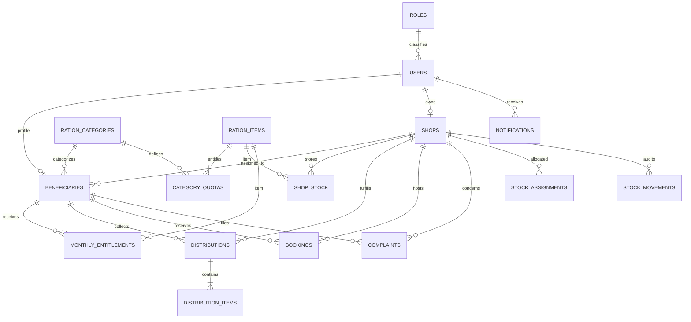

# Database Design

The PHP backend installs a clean MySQL 8+ schema from `backend/database/database.sql` and its initial data from `backend/database/seed.sql`. It does not use the older Node schema in place: that schema and `setup.js` differ, so legacy data must be migrated deliberately rather than pointed at the new tables.

## Entity relationships

## Tables

| Table | Purpose and important constraints |
| --- | --- |
| `roles` | Three system roles: `admin`, `shopkeeper`, `user` (beneficiary), separated from user identity. |
| `users` | Login identity, password hash, role, username/email, contact, Aadhaar, approval state and timestamps. Username/email/Aadhaar are unique when present. |
| `shops` | Shopkeeper-owned shop, unique owner and license, address, capacity, open/approval state. |
| `beneficiaries` | One-to-one beneficiary details, unique ration-card number, card category, family/address, assigned shop, both verification flags, optional uploaded image path. |
| `ration_categories` | APL, BPL, AAY and PHH lookup values. |
| `ration_items` | Unique product name and its unit, shared by quota, stock and history rows. |
| `category_quotas` | Unique monthly numeric quantity and price per category/item. |
| `shop_stock` | Numeric allocation and distribution by shop, item and `YYYY-MM` period. A check prevents negative or over-distributed stock. |
| `monthly_entitlements` | Numeric quota and remaining amount by beneficiary, item and month; supports atomic distribution accounting. |
| `distributions` | Distribution header with beneficiary, shop, issuer and month/time. |
| `distribution_items` | Item-level quantity and price snapshot under each distribution. |
| `bookings` | Beneficiary, assigned shop, date, slot and status. A generated nullable date plus unique key prevents more than one active booking per beneficiary/day while permitting rebooking after cancellation. |
| `complaints` | Beneficiary/shop complaint, workflow status, admin response and resolver. |
| `notifications` | Individual, shop, role or global notice; read state is a timestamp. |
| `stock_assignments` | Admin allocation to a shop, pending/received/cancelled state and receipt audit. |
| `stock_movements` | Append-only inventory add/distribution/adjustment history. |

## Normalization notes

Role and card category names are lookup entities. Quotas and stock reference ration items by ID rather than repeating product labels. Quantities and prices are numeric values; units come from the item, and currency is represented as an amount rather than formatted text. Beneficiary and shopkeeper profile data are separate from login credentials. Distribution headers and lines separate transaction-level facts from the variable list of items. Monthly entitlements and stock use explicit period keys, with unique constraints enforcing one row per owner/item/period. Audit and notification data are separate from mutable current-state rows.

Foreign keys protect references. Cascades are limited to user-owned profiles and shop-owned operational rows where dependent data should not outlive the owner; transaction and complaint references otherwise remain restrictive. Checks, unique keys, and indexes enforce positive quantities, valid category codes, lookup uniqueness, and common role/shop/status/time queries.

## Distribution transaction

The service runs one PDO transaction, locks beneficiary, entitlement and stock rows, verifies approvals, shop assignment, quota and available stock, then writes a distribution and its line. It updates remaining entitlement and distributed stock and records stock movement/history before commit. Any validation or SQL exception rolls back the entire transaction.

## Initial data

`backend/database/seed.sql` inserts lookup rows and an approved admin, shopkeeper, beneficiary, shop, quota configuration and sample stock. Demo passwords are `admin123`, `shop123`, and `user123`; only PHP-generated password hashes are stored. Change these credentials before any public deployment.
