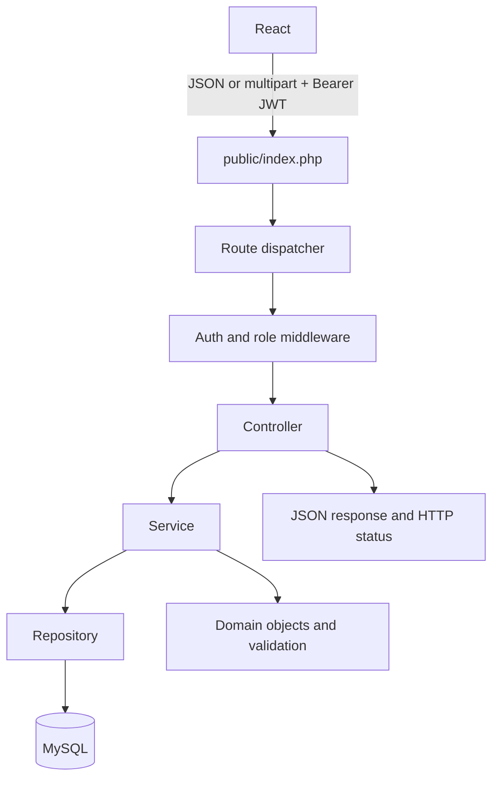

# PHP OOP Design

The backend uses PHP 8+, PDO and a small PSR-4-style autoloader; it does not depend on a web framework. `public/index.php` is the HTTP entry point and `routes/api.php` wires paths to controllers.

## Request flow

## Layers and ownership

| Layer | Responsibility |
| --- | --- |
| `config/` | Environment configuration, one reusable PDO connection, JWT signing/verification. |
| `interfaces/` | Contracts for the user model, repositories and services. |
| `models/` | Encapsulated domain types. An abstract `User` implements `UserInterface`; `Admin`, `Shopkeeper` and `Beneficiary` specialize it. `UserFactory` returns the correct subtype from a role, demonstrating polymorphic construction used during authentication. |
| `repositories/` | Prepared PDO queries and transactions. Repositories do not decide HTTP responses. |
| `services/` | Registration/login/approval, monthly quota, stock, distribution, booking, complaint and notification rules. Services receive their repositories through constructors. |
| `controllers/` | Convert request data and route parameters to service calls; no SQL or business rules. |
| `middleware/` | Verify bearer JWT, reload approval state, and enforce an allowed role. |
| `routes/` | Path, method, middleware and controller wiring only. |
| `utils/` | Request parsing, field validation, JSON responses and exception-to-status conversion. |

## OOP concepts demonstrated

- **Encapsulation:** user model state and infrastructure dependencies are private, exposed through deliberate methods.
- **Abstraction:** abstract `User` represents shared identity behavior without allowing a generic user instance.
- **Inheritance:** role types extend the shared user base and provide their role identity.
- **Interfaces:** user, repository and service contracts allow controller/service collaborators to depend on behavior rather than a particular implementation.
- **Polymorphism:** the user factory returns role-specific implementations through `UserInterface`; callers can use common identity methods without branching over storage details.
- **Dependency injection:** controllers receive services; services receive repository contracts; repositories receive the shared PDO connection.
- **Exception handling:** validation, authorization, not-found and unexpected database failures become safe JSON responses with appropriate status codes. SQL errors are logged server-side, not exposed.

This architecture stays deliberately small enough to trace in a mini-project viva. Authentication, profile, inventory and distribution rules are kept in their owning domain services rather than being split into a framework-like number of classes.
